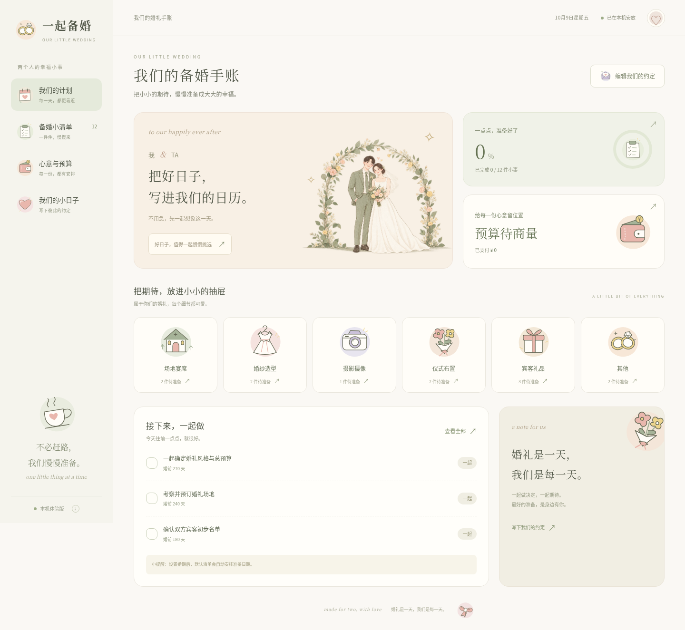

# 一起备婚

给两个人用的备婚手账，包含**原生微信小程序 + 可以在电脑上运行的 Web Demo**。奶油白、鼠尾草绿和淡粉色的韩式简洁界面，搭配 20 款插画图标与生成的婚礼人物主视觉。

目前默认是**本机体验版**，婚期可以在应用中设置或留空。Web 无需微信账号、AppID 或云服务；小程序可在微信开发者工具的测试号 / 游客模式中体验。双人跨设备同步和微信上传需要注册小程序并配置云开发。



## 在自己的电脑上运行 Web Demo

安装 [Node.js 20 或更新版本](https://nodejs.org/)，下载源码后进入包含 `package.json` 的 `Wedding` 目录：

```sh
cd Wedding
npm run web
```

在**运行命令的这台电脑**的浏览器中打开 `http://127.0.0.1:4173`。Web 没有第三方运行时依赖，无需先运行 `npm install`。终端保持打开，按 `Ctrl+C` 停止。端口占用时运行 `npm run web -- --port 4174`，再打开对应地址。

先点首页“编辑我们的约定”，填入称呼、婚期和预算，然后体验清单分工和开支记录。支持电脑与手机宽度；更详细的运行、备份和手机浏览方式见 [Web Demo 使用说明](docs/web-demo.md)。

Web 数据保存在当前浏览器的本地存储中，小程序数据保存在微信本地存储中，**两端不共享数据**。Web 的“我们”页支持 JSON 备份导入 / 导出；清除浏览器数据或更换浏览器前请先备份。当前 Web Demo 不会连接微信云服务。

## 已实现

- **计划**：婚礼倒计时、备婚进度、接下来的任务、默认清单准备阶段。
- **清单**：12 项可编辑的初始任务；新增、修改、删除、完成 / 重新打开；按状态、分类、负责人筛选和搜索。
- **预算**：总预算、每笔预计金额和已付金额、分类汇总、超预算提醒。金额以“分”计算，避免小数相加误差。
- **预算与安排绑定**：一件事项可关联多笔开支，清单显示该事项的预计 / 已付汇总，预算支持按事项筛选和返回事项详情。已有开支可补绑定、换绑或解绑。
- **付款日期提醒**：每笔开支可设置付款日期，首页和预算页展示未付清记录的到期 / 逾期状态，付清后自动移出提醒。当前是应用内提醒，不会主动发送微信消息。
- **我们**：设置双方称呼、婚期、场地和总预算；复制可分享的文字摘要。
- **插画**：20 款本地插画图标、两端统一的人物主视觉和可浏览的插画小册；所有图片随源码提供，无外链依赖。
- **小程序交互**：页面左右 48rpx 留白、卡片内边距与底部安全区；按钮 / 卡片按压反馈、页面内容淡入、勾选与进度过渡，以及圆角弹层滑入 / 滑出。系统支持“减少动态效果”时会简化动画。
- **Web 备份**：JSON 导入 / 导出、无效备份校验、多个标签页修改冲突提示。
- **双人空间代码**：创建空间、邀请码加入、两人访问控制、云端保存和并发修改冲突提示。尚未连接实际微信云环境，不能把本机模式当作已实现跨设备同步。

婚期可以一直留空。填写或改变婚期后，初始任务的相对截止时间会自动调整；手动指定过的日期不会跟着改变。所有任务都可以改成适合你们自己的安排。

### 将预算绑定到安排

在“清单”卡片点“＋ 关联预算 / 开支”，再添加开支，即会默认绑定当前事项。也可以编辑已有开支，在“关联安排”中选择事项。选择“暂不关联安排”可解绑。删除事项仅解除关联，账目和付款日期都会保留。

例如摄影共 8,000 元，分两期付款：分别记录“摄影定金”预计 2,000 元和“摄影尾款”预计 6,000 元，两笔都绑定到“挑选摄影与摄像团队”，填写各自的付款日期和已付金额。不要再重复录入一笔 8,000 元总额，否则会重复计入预算。

首页和预算页按付款日期显示最近 3 笔未付清开支，其余日期在开支记录里查看。重新打开页面会更新日期状态；Web 切回页面也会刷新。完成事项与付清账目各自记录，设置的付款日期不随婚期自动移动。旧记录可继续使用，没有自动绑定或预设付款日期。

## 在微信开发者工具中体验小程序

1. 安装[微信开发者工具稳定版](https://developers.weixin.qq.com/miniprogram/dev/devtools/download.html)。
2. 选择“导入项目”，目录选本仓库根目录 **Wedding**，包含 `project.config.json` 的那一层。
3. 使用工具提供的测试号 / 游客模式。仓库默认 `appid` 是 `touristappid`；不同版本入口名称可能不同。若工具要求登录，用自己的微信扫码登录开发者工具即可。
4. 选择普通“小程序”项目并编译。前端无 npm 依赖，不需要点“构建 npm”，也不需要启动 Web 服务器。
5. 打开“我们 → 编辑”，填写你们的称呼、婚期和总预算，再体验“清单”和“预算”。

本机数据保存在 `wx` 本地存储中。重编译通常会保留；清理模拟器缓存、清理微信数据或更换设备可能丢失。复制摘要是可阅读的记录，不是可导入的数据备份。

## 接通微信和伴侣同步

完整步骤见 [微信导入、双人空间与上传](docs/wechat-setup.md)。先注册并获得 AppID，再开启云开发、部署 `wedding` 云函数和三个数据库集合。无需把 AppSecret、微信登录凭证或云密钥写到代码里。

一方先创建共同空间并生成邀请码，另一方选择“加入伴侣的空间”。**不要两个人都先创建各自的空间**。邀请码 7 天有效、仅能绑定另一位成员；重新生成后旧码失效。本版本暂不提供解绑或更换伴侣。

云端更新在打开页面和下拉刷新时读取，不是持续实时推送。网络错误不会伪装成保存成功；本机和云端数据各自保留，不会静默互相覆盖。

## 本地开发与检查

使用 Node.js 20 或更新版本：

```sh
npm ci
npm run verify
```

`npm run verify` 检查页面配置、资源引用、JS / WXML 基础结构、共享模型是否同步，再执行 34 项业务、关联与提醒、页面、弹层生命周期、云服务和 Web 服务器测试。它不能替代微信开发者工具的编译和真机测试。

可选的 `npm run test:web` 在真实 Chromium 中检查桌面和手机布局、婚期编辑、任务分工、预算、备份和多标签页冲突。需要额外安装 Playwright 和 Chromium，安装方式见 [Web Demo 使用说明](docs/web-demo.md)。普通体验不需要它们。

当前云工作区还保留了可选的腾讯 Linux 模板编译器，可运行 `node scripts/check-native-templates.js /workspace/.tools/wedding-compiler/node_modules/miniprogram-compiler`，检查原生 WXML / WXSS 编译和页面渲染树。其他机器可在仓库外安装 `miniprogram-compiler@0.2.3` 并把安装路径传给同一脚本。具体已验证范围见 [验证记录](docs/validation.md)。

安装上述编译器与 Playwright 后，可运行 `node scripts/check-task-layout.js /绝对路径/miniprogram-compiler`。它在浏览器中加入微信 v2 默认按钮尺寸，检查事项的方形勾选框、文字宽度、筛选按钮和长标题换行，防止默认按钮样式再次挤占内容。此辅助检查不能替代真机预览。

修改 `shared/domain.js` 后执行 `npm run prepare`。仓库内的两份输出用于让小程序和单独部署的云函数使用同一套验证规则；无需将运行时依赖放进前端。

开发云函数时：

```sh
cd cloudfunctions/wedding
npm ci
```

目录：

```text
miniprogram/             微信小程序源码，四个页面和公共样式
web/                     响应式 Web Demo，复用同一份业务模型
cloudfunctions/wedding/  双人空间云函数，可独立部署
shared/domain.js         日期、金额、任务、预算和数据校验
design/                  原始婚礼主插画及素材说明
scripts/                 本机服务器、插画构建、共享代码同步和检查
tests/                   业务、页面流程、Web 服务器和双人协作测试
docs/                    Web 运行、微信部署、截图和验收记录
```

## 验收范围

自动化测试包含：本机完整使用流程、日期联动、精确金额汇总、数据持久化、权限隔离、邀请码过期 / 换码、第三人加入限制、两人同时保存冲突，以及网络失败时不写入本机伪装同步。

尚需真实 AppID 后完成：微信开发者工具和真机的界面操作验证、真实云数据库事务、两台手机同步、体验版上传及审核发布。当前未上传或发布到微信。
