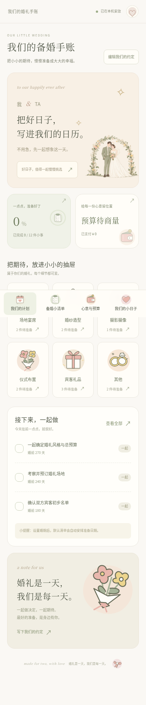

# Web Demo 使用说明

## 启动

1. 安装 Node.js 20 或更新版本。
2. 下载 / 解压完整仓库，在包含 `package.json` 的目录打开终端。
3. 运行 `npm run web`，在同一台电脑上打开 `http://127.0.0.1:4173`。

不需要微信账号、AppID、数据库或 npm 依赖安装。不要直接双击 `web/index.html`：共享脚本和素材需要通过本机服务器读取。按 `Ctrl+C` 停止；下次仍用同一命令启动。

若 4173 端口已占用，使用 `npm run web -- --port 4174` 并访问对应端口。浏览器数据按地址和端口隔离，切换端口不会自动带走原来的数据。

## 可以体验什么

- **计划**：设置两人称呼、婚期、场地和总预算，查看倒计时、进度、待办与准备阶段。
- **清单**：12 项初始任务，新增 / 编辑 / 删除 / 完成，按负责人、分类、状态筛选或搜索。更改婚期会移动初始任务的相对日期；手动指定的日期保留。
- **预算**：分别记录预计金额与已付金额，查看各类别汇总和剩余预算。
- **我们**：编辑资料、复制摘要、导出 / 导入备份、浏览 20 款插画、确认后重置本机数据。

桌面为左侧导航，窄屏自动切换到底部导航。配色与插画同样用于原生微信小程序。



## 保存与备份

数据自动保存在当前浏览器的 `localStorage`。刷新页面或重启服务器后会保留；隐私模式、清除网站数据和更换浏览器可能导致数据丢失。“我们 → 收好一份备份”可以下载 JSON；“打开已有备份”会校验内容，并要求确认替换。

多个同源标签页会刷新彼此的改动。若编辑期间另一页保存了新版本，会提示冲突并保留当前输入，避免静默覆盖。遇到损坏的本地数据时可以先导出原始记录，再选择重置。

Web 与微信小程序使用不同的本机存储。Web 不接入微信云开发，也不提供两台设备之间的自动同步。两人真实同步的配置见 [微信说明](wechat-setup.md)。

## 在同一 Wi-Fi 的手机上浏览

在自己的电脑上运行：

```sh
npm run web -- --host 0.0.0.0
```

手机与电脑连接同一 Wi-Fi，在手机浏览器打开 `http://电脑的局域网IP:4173`（例如 `http://192.168.1.10:4173`），并在需要时允许系统防火墙的本地网络访问。默认启动仅监听本机；此选项允许同一网络上的设备读取 Demo 页面。手机仍保存自己的数据，不会自动得到电脑上的计划；可通过 JSON 备份转移。

这只是本地体验服务器，没有账号认证；不要将端口转发到公网。局域网 HTTP 页面不能使用剪贴板 API 时，应用会显示可手动复制的摘要。

## 可选的开发检查

无需安装额外依赖即可运行基础检查：

```sh
npm run verify
```

浏览器端自动化检查需要 Playwright 和 Chromium。为避免改动项目的零依赖清单，可以在仓库之外安装工具，例如在仓库的上一级目录执行：

```sh
npm install --prefix wedding-browser-tools playwright@1.62.1
```

然后在 `wedding-browser-tools` 目录执行 `npx playwright install chromium`。回到仓库，设置 `WEDDING_PLAYWRIGHT_PATH` 为该工具的绝对模块路径并运行测试。macOS / Linux 示例：

```sh
WEDDING_PLAYWRIGHT_PATH="/Users/you/projects/wedding-browser-tools/node_modules/playwright" npm run test:web
```

将示例路径替换为自己机器上的绝对路径。Windows PowerShell 示例：

```powershell
$env:WEDDING_PLAYWRIGHT_PATH = "C:\projects\wedding-browser-tools\node_modules\playwright"
npm run test:web
```

也可用 `WEDDING_BROWSER_PATH` 指向已有的 Chromium 可执行文件。测试会启动独立临时服务器和浏览器，不会覆盖你平常使用浏览器中的计划；截图目录可用 `WEDDING_SCREENSHOT_DIR` 设置。

插画构建脚本与原始主视觉说明见 [design/README.md](../design/README.md)。正常运行 Demo 或导入微信开发者工具时，直接使用已生成的素材即可。
